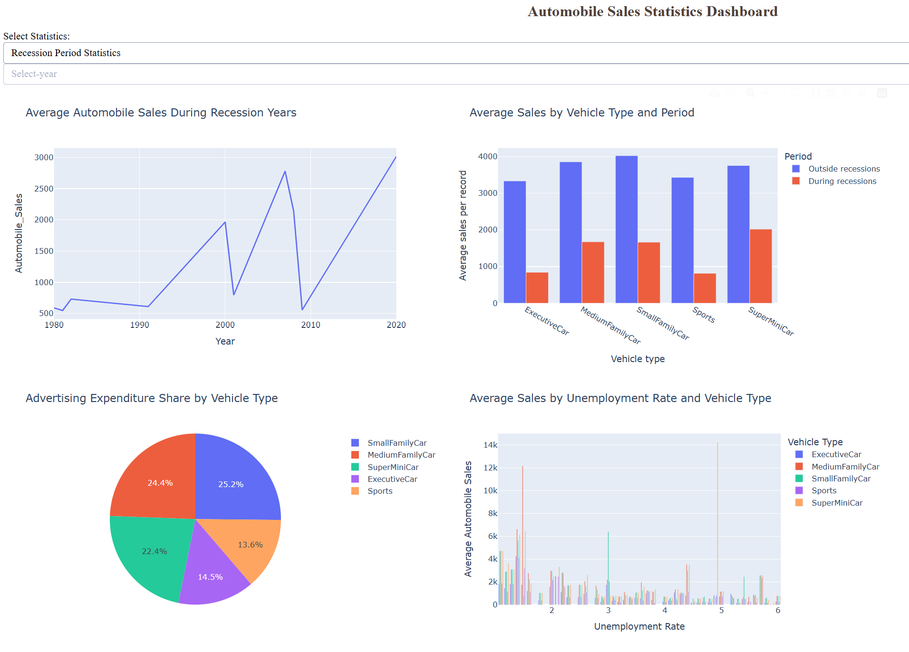
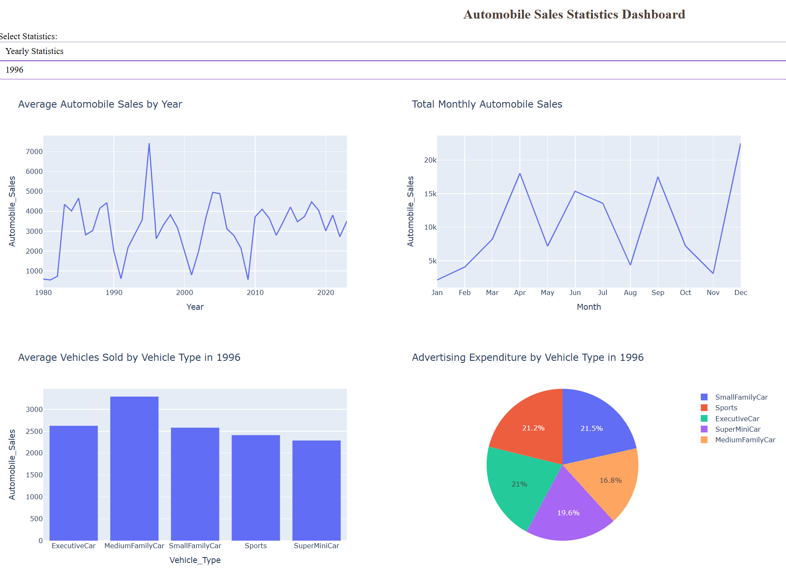

# Automobile Sales During Recessions

How did average automobile sales differ during and outside recessions, and which vehicle types showed the largest gaps? I explored these questions in a [Python notebook](analysis.ipynb) and built a Dash dashboard to compare the results across vehicle types and years.

## Key findings

- Average sales were **62.5% lower during recessions** in the simulated dataset, at about **1,382 per record** versus **3,680** outside recessions.
- Average sales were lower during recessions for all five vehicle types. Sports cars and executive cars had the largest percentage gaps at about **76%** and **75%**. Superminis had the smallest gap at about **46%**.

My quantitative methods coursework at Aarhus BSS shaped how I interpreted these results. The figures are descriptive, and the mix of months and vehicle types can influence the overall gap. A follow-up would compare the same vehicle types in the same calendar months across both periods.

## Dashboard

### Recession overview

The grouped bar chart compares average sales per record during and outside recessions for each vehicle type.



### Yearly view (1996)

The year selector updates monthly sales, average sales by vehicle type, and advertising expenditure. The annual sales chart provides historical context across the full dataset.



## Run locally on Windows

With Python installed, open PowerShell in the project folder and run each command below.

```powershell
py -m venv .venv
.\.venv\Scripts\python.exe -m pip install -r requirements.txt
.\.venv\Scripts\python.exe app.py
```

Keep the terminal running and open [the dashboard](http://127.0.0.1:8050/). Select **Recession Period Statistics** for the overview or **Yearly Statistics** and a year for the yearly view.

To run the analysis, open [analysis.ipynb](analysis.ipynb) in VS Code with the Python and Jupyter extensions, select the `.venv` kernel, and run the cells from top to bottom.

## Data and tools

This project is based on IBM Skills Network’s *Data Visualization with Python* course. The [IBM dataset](https://cf-courses-data.s3.us.cloud-object-storage.appdomain.cloud/d51iMGfp_t0QpO30Lym-dw/automobile-sales.csv) contains simulated automobile sales records from 1980 to 2023.

I used pandas to filter and group the data, Matplotlib and Seaborn for notebook charts, Folium for the map, and Plotly and Dash for the dashboard.
